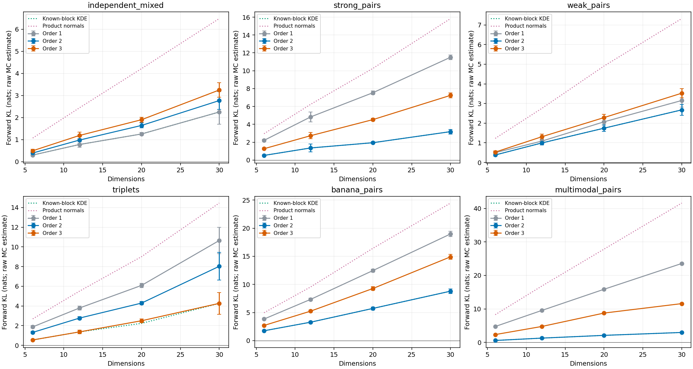
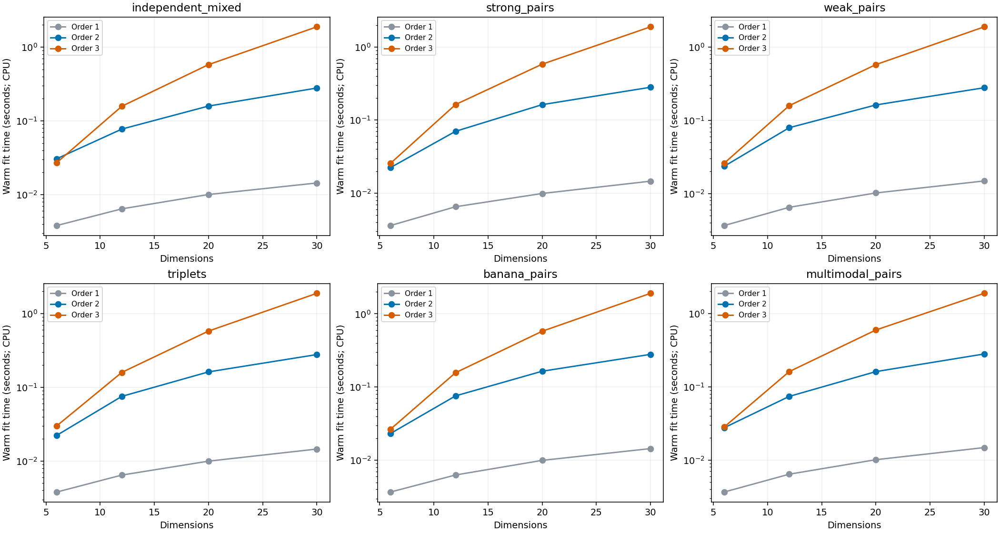
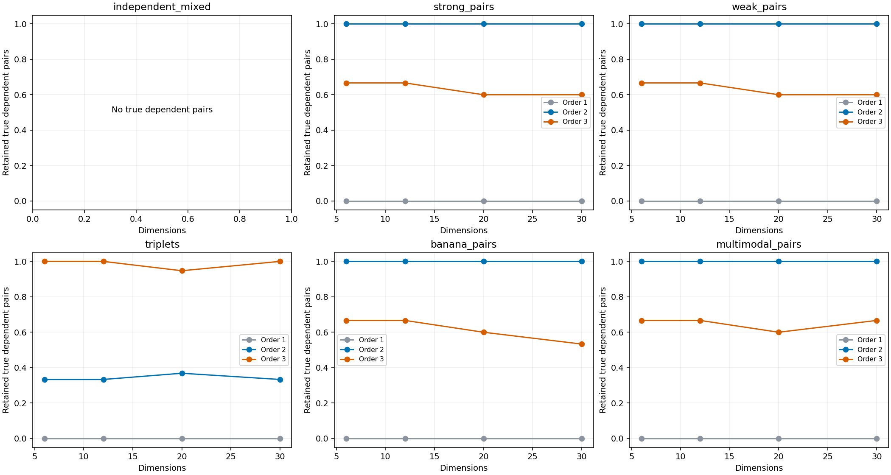
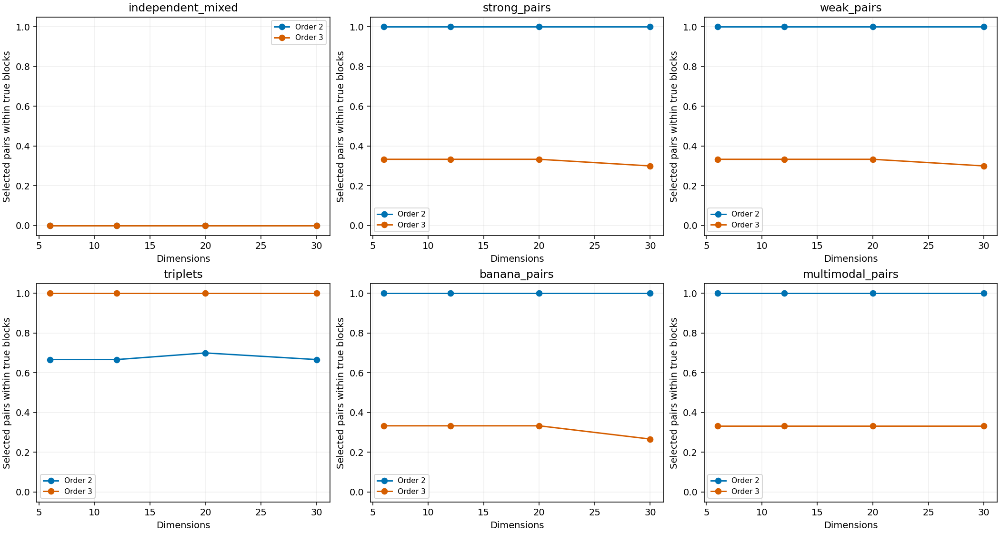

# JAX Morph block benchmark results

Six analytic target families at 6, 12, 20, and 30 dimensions; shuffled input columns.
Each fit uses 1,000 sample vectors (1,000 values per parameter), followed by separate
1,000-vector evaluation and proposal batches. Main TC scoring uses a reproducible
256-point subset; final KDE factors use all 1,000 fitting vectors. The 30D ablations
compare TC scoring on all 1,000 fitting vectors. SGM tries up to 64 seeds.

Forward KL is estimated on independent truth samples, in nats, without clipping.
The reported SE describes evaluation Monte Carlo error, not variation between fits.
These are single-training-seed benchmarks. Pair recall and precision measure
retained dependencies and spurious mergers. Orders 2 and 3 force same-size blocks:
they cannot reproduce every mixed partition exactly. Independent targets have
undefined pair recall. The known-block KDE baseline removes selection error while
retaining KDE smoothing error. Proposals outside bounded support are retained:
reverse KL is infinite when leakage is observed; no support floor is substituted.






## 30-dimensional main results

| Target | Order | KL ± MC SE (nats) | Pair recall | Pair precision | Warm fit (s) |
| --- | ---: | ---: | ---: | ---: | ---: |
| independent_mixed | 1 | 2.247 ± 0.278 | — | — | 0.014 |
| independent_mixed | 2 | 2.765 ± 0.204 | — | 0.000 | 0.279 |
| independent_mixed | 3 | 3.244 ± 0.168 | — | 0.000 | 1.888 |
| strong_pairs | 1 | 11.508 ± 0.135 | 0.000 | — | 0.015 |
| strong_pairs | 2 | 3.180 ± 0.131 | 1.000 | 1.000 | 0.281 |
| strong_pairs | 3 | 7.242 ± 0.141 | 0.600 | 0.300 | 1.889 |
| weak_pairs | 1 | 3.153 ± 0.174 | 0.000 | — | 0.015 |
| weak_pairs | 2 | 2.676 ± 0.143 | 1.000 | 1.000 | 0.279 |
| weak_pairs | 3 | 3.525 ± 0.118 | 0.600 | 0.300 | 1.894 |
| triplets | 1 | 10.651 ± 0.680 | 0.000 | — | 0.015 |
| triplets | 2 | 8.030 ± 0.720 | 0.333 | 0.667 | 0.278 |
| triplets | 3 | 4.267 ± 0.562 | 1.000 | 1.000 | 1.885 |
| banana_pairs | 1 | 18.978 ± 0.227 | 0.000 | — | 0.014 |
| banana_pairs | 2 | 8.800 ± 0.207 | 1.000 | 1.000 | 0.280 |
| banana_pairs | 3 | 14.908 ± 0.211 | 0.533 | 0.267 | 1.904 |
| multimodal_pairs | 1 | 23.560 ± 0.082 | 0.000 | — | 0.015 |
| multimodal_pairs | 2 | 2.959 ± 0.062 | 1.000 | 1.000 | 0.280 |
| multimodal_pairs | 3 | 11.574 ± 0.077 | 0.667 | 0.333 | 1.883 |

## Inspect all parameters

Corner plots overlay the independent truth draw and all three Morph orders.
Pages contain at most six parameters and together cover every parameter.
Coordinates are displayed in true-block order; fitting used shuffled columns.
Quantile limits affect plotting only. Full-support samples enter KL and diagnostics.

- **independent_mixed:** [page 1](plots/corner_independent_mixed_30d_p1.png) · [page 2](plots/corner_independent_mixed_30d_p2.png) · [page 3](plots/corner_independent_mixed_30d_p3.png) · [page 4](plots/corner_independent_mixed_30d_p4.png) · [page 5](plots/corner_independent_mixed_30d_p5.png) · [blocks](plots/blocks_independent_mixed_30d.png)
- **strong_pairs:** [page 1](plots/corner_strong_pairs_30d_p1.png) · [page 2](plots/corner_strong_pairs_30d_p2.png) · [page 3](plots/corner_strong_pairs_30d_p3.png) · [page 4](plots/corner_strong_pairs_30d_p4.png) · [page 5](plots/corner_strong_pairs_30d_p5.png) · [blocks](plots/blocks_strong_pairs_30d.png)
- **weak_pairs:** [page 1](plots/corner_weak_pairs_30d_p1.png) · [page 2](plots/corner_weak_pairs_30d_p2.png) · [page 3](plots/corner_weak_pairs_30d_p3.png) · [page 4](plots/corner_weak_pairs_30d_p4.png) · [page 5](plots/corner_weak_pairs_30d_p5.png) · [blocks](plots/blocks_weak_pairs_30d.png)
- **triplets:** [page 1](plots/corner_triplets_30d_p1.png) · [page 2](plots/corner_triplets_30d_p2.png) · [page 3](plots/corner_triplets_30d_p3.png) · [page 4](plots/corner_triplets_30d_p4.png) · [page 5](plots/corner_triplets_30d_p5.png) · [blocks](plots/blocks_triplets_30d.png)
- **banana_pairs:** [page 1](plots/corner_banana_pairs_30d_p1.png) · [page 2](plots/corner_banana_pairs_30d_p2.png) · [page 3](plots/corner_banana_pairs_30d_p3.png) · [page 4](plots/corner_banana_pairs_30d_p4.png) · [page 5](plots/corner_banana_pairs_30d_p5.png) · [blocks](plots/blocks_banana_pairs_30d.png)
- **multimodal_pairs:** [page 1](plots/corner_multimodal_pairs_30d_p1.png) · [page 2](plots/corner_multimodal_pairs_30d_p2.png) · [page 3](plots/corner_multimodal_pairs_30d_p3.png) · [page 4](plots/corner_multimodal_pairs_30d_p4.png) · [page 5](plots/corner_multimodal_pairs_30d_p5.png) · [blocks](plots/blocks_multimodal_pairs_30d.png)

## Reproduce

```bash
python -m pip install -e '.[test,benchmark]'
python -m benchmarks.block_suite --output benchmark-results/blocks-2026-10-05
```

`results.json` contains configurations, all partitions, hardware, dependency versions,
implementation hashes, first and warm timings, support leakage, and importance ESS.
`metrics.csv` contains scalar results; `targets.json` records exact target parameters.
The workflow pins dependencies in `.github/workflows/block-benchmarks.yml`.
First-call timings may reuse compiled shapes from earlier cases; they are not isolated
compiler timings. Warm fits include scoring and selection; SGM-only times are separate.
No GPU speed or speedup relative to the original MorphZ is inferred from this CPU run.
