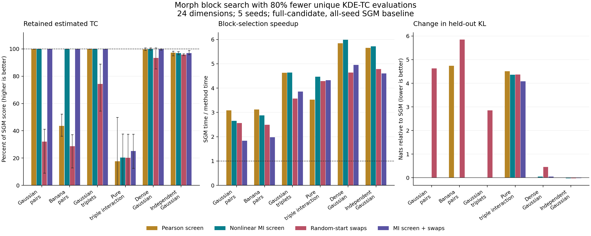

# Reducing TC evaluations when fitting Morph

Experiment date: 6 October 2026 (Pacific/Auckland).

**Recommendation:** use cheap nonlinear dependence screening to build a small candidate
pool, evaluate KDE-based TC only for this pool, and solve the restricted partition
problem. Add stochastic repartition moves when validation justifies a larger search.
These experiments favor screening over random-start stochastic search. This is an
isolated research prototype; the production `fit` API was not modified.

## Why the search can be lazy

The supplied paper, *Enhancing evidence estimation through informed probability
density approximation*, Section III, Eqs. 5-8, defines the objective

$$F(B)=\sum_{b\in B}C(b),\qquad |B|=\lfloor d/L\rfloor,$$

with disjoint blocks of width L and remaining coordinates fitted as singletons.
Algorithm 1 computes all binomial(d,L) block scores before starting SGM. Reducing
the number of SGM seeds only reduces the later selection stage.

For a repartition of two or three existing factors, only changed factors contribute:

$$\Delta F=\sum_{b\in B_{new}}\widehat C(b)-\sum_{b\in B_{old}}\widehat C(b).$$

Cache scores by sorted coordinate tuple. Each new two-block proposal needs at most
two new TC evaluations; a three-block proposal needs at most three. Unchanged factors
cancel. Every state remains a valid normalized Morph product. Include residual
singletons in moves when d is not divisible by L.

## Alternatives implemented and tested

1. **Nonlinear screening + restricted optimization.** Compute pairwise MI from
   six quantile bins, using counts instead of KDE. For each coordinate form blocks
   with its five strongest neighbors, rank these by summed pairwise MI, and retain
   a budgeted shortlist. Include a random feasible partition and reserve about 20%
   of the pool for random blocks. Compute actual KDE TC only on this pool. A small
   binary set-packing MILP selects exactly floor(d/L) disjoint blocks. Its optimum
   is only an optimum within the pool; it gives no guarantee over omitted blocks.
2. **Stochastic partition search.** Start from a random partition. In each round,
   propose eight random repartitions of two factors (75%) or three factors (25%).
   Score unseen blocks in batches, select the best proposed move, occasionally
   accept a worsening move under a cooling temperature, and retain the best state
   seen. Reset to that best state every 30 rounds. This is an optimization heuristic,
   not an MCMC sampler or a convergence-certified annealing method.
3. **Hybrid.** Spend 60% of the TC budget on nonlinear screening and restricted
   optimization, then use the remainder for stochastic refinement. It cannot lower
   the score of its own starting partition, but its smaller initial pool means it
   need not beat the screening-only method under the same total budget.
4. **Pearson screening control.** Use squared Pearson correlation in place of
   binned MI. This tests whether simple linear screening is sufficient.

For L=2, replace the restricted MILP with maximum-weight, maximum-cardinality
general-graph matching, e.g. [Blossom via NetworkX](https://networkx.org/documentation/stable/reference/algorithms/generated/networkx.algorithms.matching.max_weight_matching.html).
Retaining a feasible scaffold guarantees that the sparse graph admits the required
matching cardinality. Matching alone does not reduce the cost of obtaining edge
weights. For L>=3, the prototype uses [SciPy MILP / HiGHS](https://docs.scipy.org/doc/scipy/reference/generated/scipy.optimize.milp.html),
with a five-second limit and checked status. All 90 restricted solves in the main
experiment reached an optimum for their candidate pools.

**Cost:** direct plug-in KDE scoring costs roughly O(n_TC^2) per block at fixed L.
Exhaustive evaluation costs O(binomial(d,L) n_TC^2), plus marginal scoring and
selection. A fixed B-block search replaces the combinatorial factor by B.
Screening still costs O(n_TC d^2) for cheap binned pair statistics, and generates
at most O(d binomial(k,L-1)) neighbor candidates with fixed k. At L=2 this still
examines every pair cheaply: the saving is avoiding *KDE* TC on all pairs.
For genuine subquadratic dependence discovery at very large d, random neighborhoods
or model-informed neighborhoods would be needed; they were not tested here.

## Test design

- 24 dimensions; six scenarios; five independent dataset/search seeds: 150 fitted
  densities across five methods. Baseline evaluates all blocks and tries **every
  SGM seed**, using the repository's JAX implementation with early stopping.
- 256 scoring samples, 512 final KDE fitting samples, 1,024 independent posterior
  evaluation samples, and 1,024 proposal samples for each bridge estimate. Scoring
  samples are a subset of fit samples; evaluation samples are independent.
- Same clipped in-sample KDE plug-in TC, Gaussian KDE convention, bandwidth and
  final fitting samples across methods. Every method has its own TC cache and cannot
  access baseline scores. All selected partitions are checked for validity.
- Budgets: 55 of 276 possible pairs; 404 of 2,024 possible triplets. Counts refer
  to unique block scores; padded 16-block kernel batches perform extra work,
  recorded separately in the raw results. Marginal entropies are computed once per
  method and included in elapsed time. Baseline-only candidate enumeration is
  outside the timer, which conservatively favors SGM.
- Timings include screening, score evaluation, Python orchestration and optimization;
  they exclude JIT warmup, final KDE fitting, quality checks and bridge sampling.
  They are **block-selection timings, not whole-MorphZ speedups**. Shared-machine
  timings are indicative. Medians below use paired seed-wise timing ratios.
- Exact normalized synthetic targets have log Z = 0. Reported evidence RMSE is
  sqrt(mean(log Z estimate squared)) across five runs. Held-out KL is Monte Carlo
  mean(log p - log fitted Morph), in nats; lower is better. Neither metric is used
  to tune these runs. All 150 bridge iterations converged; this alone does not
  establish evidence accuracy or good overlap.
- Gaussian pairs/triplets have within-block correlation 0.8. Banana pairs use
  y=0.8(x^2-1)+0.25 epsilon. Pure triple interactions use noisy sign triples
  (A,B,A*B), with independent fair signs A,B and independent Gaussian noise sd=0.3.
  Each pair is independent but the joint triple is dependent. Coordinates are
  permuted. Dense Gaussian uses four shared latent loadings plus diagonal noise.



TC bars show means and minimum-to-maximum ranges over five seeds. Values above
100% can occur because even all-seed SGM is a heuristic, not a global optimum.
On the independent target, population TC is zero: the positive estimated scores
reflect finite-sample KDE effects, so a score ratio there is not dependence recovery.

## Results

| Target | Method | Retained TC %: mean [min, max] | Selection speedup | Held-out KL | log Z RMSE |
|---|---|---:|---:|---:|---:|
| Gaussian pairs | SGM (all seeds) | 100.00 [100.00, 100.00] | 1.00x | 0.356 | 0.018 |
| Gaussian pairs | Pearson screen | 100.00 [100.00, 100.00] | 3.08x | 0.356 | 0.018 |
| Gaussian pairs | Nonlinear MI screen | 100.00 [100.00, 100.00] | 2.65x | 0.356 | 0.018 |
| Gaussian pairs | Random-start swaps | 32.05 [9.02, 41.14] | 2.57x | 4.985 | 0.172 |
| Gaussian pairs | MI screen + swaps | 100.00 [100.00, 100.00] | 1.84x | 0.356 | 0.018 |
| Banana pairs | SGM (all seeds) | 100.00 [100.00, 100.00] | 1.00x | 7.354 | 0.239 |
| Banana pairs | Pearson screen | 43.57 [36.13, 52.27] | 3.12x | 12.094 | 0.925 |
| Banana pairs | Nonlinear MI screen | 100.00 [100.00, 100.00] | 2.88x | 7.354 | 0.239 |
| Banana pairs | Random-start swaps | 28.71 [12.90, 37.10] | 2.49x | 13.209 | 0.702 |
| Banana pairs | MI screen + swaps | 100.00 [100.00, 100.00] | 1.98x | 7.354 | 0.239 |
| Gaussian triplets | SGM (all seeds) | 100.00 [100.00, 100.00] | 1.00x | 0.580 | 0.012 |
| Gaussian triplets | Pearson screen | 100.00 [100.00, 100.00] | 4.63x | 0.580 | 0.012 |
| Gaussian triplets | Nonlinear MI screen | 100.00 [100.00, 100.00] | 4.64x | 0.580 | 0.012 |
| Gaussian triplets | Random-start swaps | 74.30 [54.46, 88.84] | 3.57x | 3.436 | 0.063 |
| Gaussian triplets | MI screen + swaps | 100.00 [100.00, 100.00] | 3.86x | 0.580 | 0.012 |
| Pure triple interaction | SGM (all seeds) | 100.00 [100.00, 100.00] | 1.00x | 4.945 | 0.147 |
| Pure triple interaction | Pearson screen | 17.71 [0.00, 49.77] | 3.52x | 9.457 | 0.635 |
| Pure triple interaction | Nonlinear MI screen | 20.39 [0.00, 37.69] | 4.47x | 9.303 | 0.544 |
| Pure triple interaction | Random-start swaps | 20.24 [0.00, 37.53] | 4.29x | 9.319 | 0.486 |
| Pure triple interaction | MI screen + swaps | 25.16 [12.56, 37.49] | 4.32x | 9.027 | 0.270 |
| Dense Gaussian | SGM (all seeds) | 100.00 [100.00, 100.00] | 1.00x | 7.387 | 0.108 |
| Dense Gaussian | Pearson screen | 99.69 [98.94, 100.73] | 5.85x | 7.397 | 0.113 |
| Dense Gaussian | Nonlinear MI screen | 99.85 [99.11, 100.73] | 5.99x | 7.436 | 0.195 |
| Dense Gaussian | Random-start swaps | 93.34 [85.40, 100.73] | 4.64x | 7.845 | 0.389 |
| Dense Gaussian | MI screen + swaps | 99.87 [99.11, 100.18] | 4.95x | 7.435 | 0.179 |
| Independent Gaussian | SGM (all seeds) | 100.00 [100.00, 100.00] | 1.00x | 0.637 | 0.020 |
| Independent Gaussian | Pearson screen | 97.24 [95.04, 98.35] | 5.66x | 0.643 | 0.024 |
| Independent Gaussian | Nonlinear MI screen | 96.91 [95.87, 97.97] | 5.72x | 0.614 | 0.020 |
| Independent Gaussian | Random-start swaps | 95.83 [95.21, 96.42] | 4.79x | 0.607 | 0.036 |
| Independent Gaussian | MI screen + swaps | 96.89 [95.74, 98.90] | 4.60x | 0.620 | 0.025 |

**Interpretation.** Nonlinear screening and the hybrid recovered the same partitions
as SGM in all 15 Gaussian-pair, banana-pair and Gaussian-triplet runs. Random-start
search spent too much of its small budget finding an initial structure. Pearson
screening missed the non-monotone banana dependencies. The hybrid gave no systematic
advantage over nonlinear screening here and usually had more overhead.

The dense Gaussian example retained about 99.85% of the baseline score with nonlinear
screening, but evidence RMSE was 0.195 versus 0.108 for SGM. Thus near-equality of
estimated TC is not sufficient evidence of equivalent downstream accuracy. Five
runs do not establish whether this difference persists. The banana baseline itself
had KL about 7.35 and evidence RMSE 0.239, illustrating the remaining KDE/overlap
problem even when block selection is correct.

The triple-interaction stress test is an explicit failure: nonlinear screening
retained only 20.39% of SGM's estimated TC; the hybrid retained 25.16%. Pairwise
independence leaves no population pairwise signal to screen on. Random exploration
helped only occasionally. None of these restricted searches guarantees detection
of pure higher-order dependence. In a black-box block-score problem, an unqueried
block can have arbitrarily large score, so no universal exact-optimum guarantee is
possible without structural assumptions or valid bounds.

## Fixed-budget dimension check

The additional 48-dimensional runs retain a budget of **404 triplets**, while the
candidate universe grows to **17,296**: 97.66% fewer unique KDE-TC evaluations.
Only two seeds per target were used, so this is a scaling spot check.

| Target | Method | TC %: mean [min, max] | Seconds | Speedup | KL | log Z RMSE |
|---|---|---:|---:|---:|---:|---:|
| Gaussian triplets | SGM (all seeds) | 100.00 [100.00, 100.00] | 7.410 | 1.00x | 1.150 | 0.016 |
| Gaussian triplets | Pearson screen | 100.00 [100.00, 100.00] | 0.192 | 39.80x | 1.150 | 0.016 |
| Gaussian triplets | Nonlinear MI screen | 100.00 [100.00, 100.00] | 0.149 | 49.95x | 1.150 | 0.016 |
| Gaussian triplets | Random-start swaps | 48.23 [46.04, 50.42] | 0.185 | 40.02x | 12.311 | 0.625 |
| Gaussian triplets | MI screen + swaps | 100.00 [100.00, 100.00] | 0.172 | 43.18x | 1.150 | 0.016 |
| Dense Gaussian | SGM (all seeds) | 100.00 [100.00, 100.00] | 21.846 | 1.00x | 19.461 | 1.078 |
| Dense Gaussian | Pearson screen | 99.26 [97.99, 100.52] | 0.212 | 102.95x | 19.207 | 0.208 |
| Dense Gaussian | Nonlinear MI screen | 98.70 [96.96, 100.43] | 0.179 | 126.67x | 19.397 | 0.988 |
| Dense Gaussian | Random-start swaps | 78.22 [77.69, 78.75] | 0.213 | 104.33x | 22.376 | 0.398 |
| Dense Gaussian | MI screen + swaps | 89.84 [89.73, 89.94] | 0.889 | 74.56x | 20.504 | 1.029 |

The large timing ratios above compare against *all-seed* SGM, including its
selection overhead. They should not be transferred directly to an implementation
using only a small number of seeds. The unique-TC counts do not depend on that
choice. In the 48d dense case, both SGM and nonlinear screening have held-out KL
around 19 nats and log Z RMSE around 1: neither provides a good density approximation
at this sample size and block order. Fast selection is not a remedy for this.

## Practical integration and further alternatives

Add a separate candidate-pool/partition-search API rather than passing an incomplete
pool to the existing SGM function, which correctly requires every combination.
Make `tc_budget`, exploration fraction, neighbor count, random key and stopping
criteria explicit. Return queried blocks/scores, selected blocks, budget use and
solver status. Then fit the ordinary Morph factors on all fitting samples.
Cache marginal entropies once across all search rounds. The current public TC
function recomputes them on each call, so calling it once per proposed move would
discard a useful saving; the prototype uses a separate cached oracle.

For the next practical version, start with nonlinear screening, preserve random
exploration and a feasible scaffold, then spend extra budget only if an independent
validation split shows an improvement in mean log Morph density or bridge overlap.
For a credible pure higher-order interaction, increase random higher-order probing,
use known model couplings to propose blocks, or revert to exhaustive scoring on a
smaller relevant coordinate group. Pairwise screening cannot certify absence.

Two further approaches are promising but **not tested** in this experiment:

- **Multiple scoring fidelities:** score proposed blocks on a small pilot sample,
  promote uncertain/promising blocks to a larger TC sample, and re-score finalists
  at one common fidelity. Combine with a fixed candidate budget. Repeated adaptive
  comparisons require care about selection bias; naive confidence bounds around
  biased in-sample KDE TC are not rigorous pruning certificates.
- **Hierarchical merging / beam growth:** grow groups along a sparse dependence
  graph using conditional MI, exploiting C(A union {j})=C(A)+I(X_j;X_A).
  Keep several partial candidates instead of committing to one merge, and repair
  block sizes at the end. Conditional MI captures effects after a useful group is
  found; it does not eliminate the initial pure-synergy discovery problem. A fixed
  beam and fixed neighbor count bound candidate growth, at the cost of pruning risk.

For KDE-based Morph, the paper's exact KL identity applies to exact target marginals.
With estimated KDE factors, also check held-out log density. Maximizing its blockwise
sum directly is a possible fitting objective; it is not identical to maximizing
clipped in-sample TC. Mixed block sizes or fitting residual variables jointly would
change the paper's fixed-order approximation and were not used here.

## Reproduction and limitations

From the repository root, with its scientific Python dependencies available:

```bash
export JAX_PLATFORMS=cpu JAX_ENABLE_X64=true
export OPENBLAS_NUM_THREADS=1 OMP_NUM_THREADS=1 PYTHONPATH=src:.
python -m benchmarks.lazy_partition_search \
  --output benchmark-results/lazy-partition-search/all-seeds.json
python -m benchmarks.lazy_partition_search --dimension 48 --tc-budget 404 --seeds 2 \
  --scenarios gaussian_triplets dense_gaussian \
  --output benchmark-results/lazy-partition-search/fixed-budget-48d.json
python -m benchmarks.lazy_partition_report
pytest -q tests/test_lazy_partition_search.py
```

The actual run used existing WSL Conda Python on CPU and an isolated temporary
bytecode cache (`PYTHONPYCACHEPREFIX=/tmp/morph-lazy-pycache`) to avoid stale OneDrive
cache files. Focused checks passed: TC equality to the production estimator, cache
and budget enforcement, restricted optimum versus exhaustive enumeration, feasible
candidate scaffold, and residual-singleton movement (four tests). These are synthetic
IID, unweighted tests, not posterior-chain or GPU benchmarks. The prototype uses
the current local source, including pre-existing changes, and existing environment
versions rather than installing the project's pinned environment. No guarantee for
real posterior data, unseen structures, bandwidths, larger L or evidence precision
is established by this pilot.

Raw observations and configuration:
[main JSON](../benchmark-results/lazy-partition-search/all-seeds.json)
and [48d JSON](../benchmark-results/lazy-partition-search/fixed-budget-48d.json).
Code: [experiment](../benchmarks/lazy_partition_search.py),
[report generator](../benchmarks/lazy_partition_report.py),
[checks](../tests/test_lazy_partition_search.py).

Environment: {"devices": "[CpuDevice(id=0)]", "jax": "0.6.2", "numpy": "2.2.6", "python": "3.10.14", "scipy": "1.15.3", "x64": true}.
